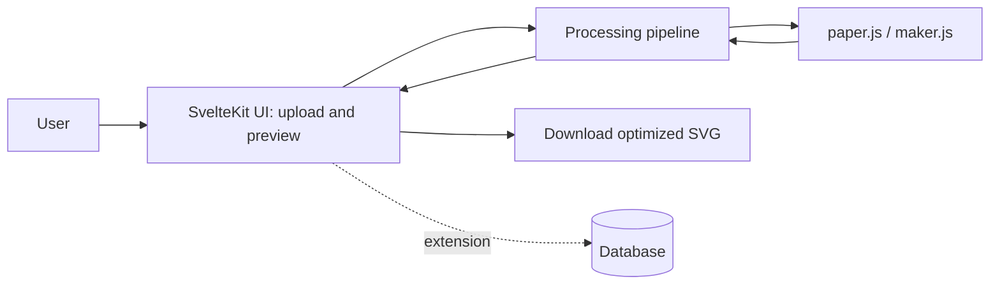

# SVG Optimizer Software for Laser Cutting

## 1. Actors and permissions
| Role | Needs | Responsibility / access |
| --- | --- | --- |
| User | Turn a raw SVG file into a clean, color-coded file ready for laser cutting | Uploads an SVG file, views the preview and statistics, downloads the optimized SVG |
| Registered user (extension) | Keep previous projects and SVG files | Signs in, saves and reopens own projects |

## 2. Use cases / user stories
### Clean and export an SVG file
- **Actor:** User
- **Precondition:** The user has a standard SVG file and has opened the application.
- **Main flow:**
  1. The actor uploads an SVG file.
  2. The system closes open curves whose endpoints are within the given tolerance.
  3. The system merges adjacent, continuous line segments into single paths.
  4. The system removes duplicate and overlapping lines.
  5. The system applies the color coding for cut and etch operations.
  6. The system shows a visual preview of the optimized result.
  7. The actor downloads the optimized SVG file.
- **Alternative / error flows:** If the file is not a valid SVG, the system shows an error message and the actor can upload another file.
- **Postcondition:** The user has a production-ready, color-coded SVG file.

### Check cut and etch length
- **Actor:** User
- **Precondition:** An SVG file has been processed.
- **Main flow:**
  1. The actor views the statistics next to the preview.
  2. The system displays the total length of cut lines and etch lines, broken down by color.
  3. The actor uses the values to estimate production time.
- **Alternative / error flows:** If no paths exist for an operation color, the system shows a length of zero for it.
- **Postcondition:** The user knows the cut and etch lengths of the optimized file.

### Handle an invalid file
- **Actor:** User
- **Precondition:** The user selects a file that is not a valid SVG.
- **Main flow:**
  1. The actor uploads the file.
  2. The system rejects the file and shows an error message.
  3. The actor uploads a different file.
- **Alternative / error flows:** None.
- **Postcondition:** The application remains usable and no result is offered for download.

## 3. Functional requirements
| Requirement | Acceptance criteria | Priority |
| --- | --- | --- |
| The user can upload and visually display a standard SVG file. | Given a valid SVG file, when the user uploads it, then the system loads and displays it. | Must |
| The system closes open curves within a given tolerance. | Given a path whose endpoints are closer than the tolerance, when the cleanup runs, then the endpoints are connected and the path is closed. | Must |
| The system merges adjacent, continuous line segments. | Given segments that form a continuous line, when the cleanup runs, then they are output as a single path. | Must |
| The system removes double lines and overlaps. | Given two lines that overlap exactly, when the cleanup runs, then only one of them remains. | Must |
| The system applies color coding for machining operations. | Given the optimized shapes, when the output is produced, then cut paths are black and etch paths are red. | Must |
| The system calculates cut and etch length. | Given the optimized shapes, when the cleanup finishes, then the total length of cut and etch lines is shown, broken down by color. | Must |
| The system displays a visual preview of the optimized result. | Given a processed file, when the cleanup finishes, then the preview shows the optimized paths. | Must |
| The user can download the processed SVG file. | Given a processed file, when the user selects download, then a valid, color-coded SVG file is saved. | Must |
| The system handles errors such as invalid SVG files. | Given an invalid SVG file, when the user uploads it, then an error message is shown. | Must |
| The system optimizes shared edges of touching shapes (common-line cutting). | Given two shapes placed next to each other, when the cleanup runs, then the shared edge is cut only once. | Could |
| The system arranges shapes on a virtual material of a given size (nesting). | Given a material size and a set of shapes, when nesting runs, then the shapes are placed using a simple bounding-box arrangement. | Could |
| The user can add tabs / microjoints to outer cutting lines. | Given an outer cutting line, when tabs are placed automatically or by click, then small breaks are added at those positions. | Could |
| The system supports kerf compensation. | Given a kerf value, when the compensation runs, then the cutting paths are adjusted accordingly. | Could |
| Registered users can save and reopen previous projects. | Given a signed-in user with a saved project, when they sign in again, then the project is available. | Could |

Priority: **Must** = required for the final product; **Should** = important; **Could** = optional if time permits.

## 4. Business rules and constraints
| Rule or constraint | Rationale |
| --- | --- |
| Black paths represent cutting and red paths represent engraving/etching. | Standard laser cutting color convention. |
| Endpoints are connected only if they are within the given tolerance. | Prevents closing gaps that are part of the design. |
| Only lines that overlap are reduced to a single line. | The laser must not cut the same place twice. |
| The application is a dedicated optimization tool, not a full vector graphics editor. | Defines the project scope. |
| Geometric operations run on the client side or in the SvelteKit Node.js environment, using external libraries (for example paper.js, maker.js). | Technical requirement of the project. |
| If user management is added, project metadata is stored persistently in a database. | Technical requirement of the project. |
| The source code is maintained in a Git-based repository. | Technical requirement of the project. |
| Secret keys, access tokens, personal or production data are not committed to the repository. | Security requirement of the project. |

## 5. User interface and workflow
The application has a main page with a file upload area, a preview of the optimized paths, a statistics panel showing cut and etch length by color, and a download button. Error messages for invalid files are shown near the upload area. If user management is added, a project list lets signed-in users reopen saved projects.

## 6. Non-functional requirements
| Requirement | How it will be verified |
| --- | --- |
| The client is built with web technologies using SvelteKit and JavaScript or TypeScript. | Review of the project setup. |
| The downloaded SVG is a valid file that opens correctly in common vector software. | Manual check of the output in Inkscape. |
| Invalid SVG files do not break the application. | Tests with invalid and empty files. |
| The source code is kept in Git and contains no secrets or production data. | Review of the repository and commit history. |

## 7. Open questions and risks
| Question / risk | Impact | Owner | Resolution / decision |
| --- | --- | --- | --- |
| Which tolerance value is suitable for closing gaps? | Too large closes real gaps, too small misses defects | Student | Make the tolerance a parameter and check results in the preview. |
| How reliably can overlapping curves be detected? | Affects the quality of overlap removal | Student | Use paper.js / maker.js operations and test on sample defective SVGs. |
| Which SVG elements must be supported? | Affects parsing effort | Student | Start with paths and basic shapes; handle the rest as errors or ignore it. |
| Is user management needed? | Affects architecture and scope | Student / supervisor | Treat as an extension after the core features are complete. |

## 8. Initial technical specification proposal
### Proposed solution
The proposed system is a SvelteKit web application. The user uploads an SVG file, and a processing pipeline closes open curves, merges continuous segments, removes duplicate and overlapping lines, applies color coding, and calculates cut and etch lengths. The result is shown in a preview and can be downloaded as a new SVG file. Geometry operations run on the client side or in the SvelteKit Node.js environment. A database is added only if user management is implemented.

### Technology direction
| Area | Candidate technology / approach | Reason for consideration | Open question / risk |
| --- | --- | --- | --- |
| Web application | SvelteKit with JavaScript or TypeScript | Required framework | Client and server boundaries must be handled carefully. |
| Geometry processing | paper.js and/or maker.js | Provide path operations, intersections, and length calculation | Which library fits overlap detection and merging best must be evaluated. |
| Version control | Git-based repository | Required by the project | None. |
| Data storage (extension) | Database for project metadata | Needed only for user management | Database must be selected if the extension is implemented. |

### Initial architecture sketch

### Feasibility and technical risks
| Risk / assumption | Validation planned for semester 2 | Fallback approach |
| --- | --- | --- |
| paper.js or maker.js can detect and remove overlapping paths reliably. | Prototype duplicate removal on a few defective sample SVG files. | Compare line segments with a numerical tolerance. |
| Gap closing with a tolerance gives correct results. | Test on sample files with known gaps. | Let the tolerance be adjusted and check the preview. |
