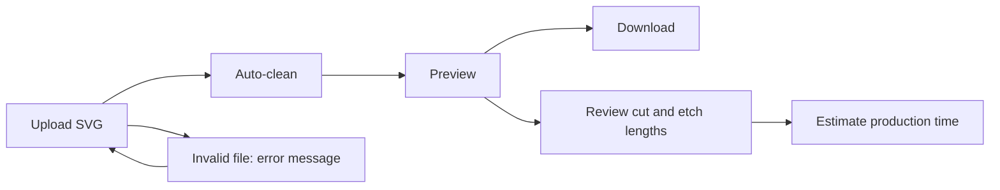

<!-- @slide Title -->

<!-- 5xl -->
# SVG Optimizer Software for Laser Cutting

*Automatic geometry cleanup for laser-ready SVG files.*

Author: Azam Zuraiz  
Neptun: CNWOG5  
Supervisor: Gergely LABORCI  
Project ID: 2026-LG-04

---

<!-- @slide Problem -->

## Problem

<!-- @set-align left -->
<!-- @set-width 70% -->

- Laser cutters follow SVG paths **exactly as drawn**, so every defect in the file becomes a defect in the part.
- Files from Illustrator or Inkscape often contain **unclosed lines, overlapping paths, and unnecessary nodes**.
- Fixing these issues by hand requires vector-editing knowledge and takes time.

<!-- @callout question -->
> How can an SVG file be cleaned automatically so that it is ready for laser cutting?

<!-- @note -->
> The result of defective files is damaged parts, wasted material, and lost machine time.

---

<!-- @slide Project idea -->

### From a raw SVG to a production-ready file

The application cleans the geometry automatically and prepares the file for manufacturing.

<!-- @note -->
> The tool is a dedicated optimizer, not a full vector editor like Inkscape.

---

<!-- @slide Target users -->

## Target users

<!-- @set-align left -->
<!-- @set-width 70% -->

**The application is intended for people who prepare SVG files for laser cutting but are not vector-geometry experts.**

- **Makers and hobbyists:** use small laser cutters and need ready-to-cut files.
- **Small workshops:** prepare repeatable files for production.
- **CNC laser operators:** receive customer-made SVGs and must fix them before cutting.

<!-- @callout info -->
> The need: fast, automatic cleanup without learning a full vector editor.

<!-- @note -->
> Validation plan: test with real defective SVG files and ask a maker or workshop for feedback.

---

<!-- @slide Planned scope -->

## Planned scope

<!-- @set-align left -->
<!-- @columns 3 3 -->

### In scope

- Upload, preview, and download SVG files
- Close open curves within a given tolerance
- Merge adjacent line segments into single paths
- Remove double lines and overlaps
- Color coding: black = cut, red = etch
- Cut and etch length statistics
- Basic error handling for invalid SVGs

<!-- @col-break -->

### Possible extensions

- Common-line cutting
- Simple bounding-box nesting
- Tabs / microjoints
- Kerf compensation
- User accounts and saved projects

### Out of scope

- A full-featured vector editor

<!-- @columns -->

<!-- @note -->
> Extensions are only started after the core pipeline is stable. The first candidate is common-line cutting, because it builds on overlap detection.

---

<!-- @slide Approach and stack -->

### Planned approach and technology

<!-- @set-align left -->
<!-- @set-width 70% -->

- **Framework:** SvelteKit with JavaScript or TypeScript.
- **Geometry:** paper.js and/or maker.js for intersections, overlaps, and path lengths.
- **Processing:** on the client side, with the SvelteKit Node.js environment as a fallback.
- **Version control:** Git-based repository; no secrets or production data are committed.

<!-- @note -->
> Client-side processing keeps user files in the browser and makes the preview instant.

---

<!-- @slide User journeys -->

## Initial user journeys

The main journeys cover cleaning and exporting, checking the numbers, and handling bad files.

---

<!-- @slide Journey 1 -->

### Clean and export

<!-- @set-align left -->
<!-- @set-width 70% -->

1. Upload an SVG file.
2. The system closes gaps, merges paths, and removes overlaps.
3. The system applies cut and etch colors.
4. Check the visual preview.
5. Download the optimized SVG.

---

<!-- @slide Journey 2 -->

### Check the numbers

<!-- @set-align left -->
<!-- @set-width 70% -->

1. Upload an SVG file.
2. Review the total cut length and etch length, broken down by color.
3. Use the values to estimate production time.

<!-- @note -->
> Lengths are calculated per color, so cutting and etching can be estimated separately.

---

<!-- @slide Journey 3 -->

### Handle bad files

<!-- @set-align left -->
<!-- @set-width 70% -->

1. Upload an invalid or empty file.
2. The system shows a clear error message.
3. Upload another file and try again.

<!-- @note -->
> An extension journey (nesting and adding tabs) will only be designed if time allows.

---

<!-- @slide Risks -->

### Main risks and mitigation

<!-- @set-align left -->
<!-- @set-width 70% -->

- **Tolerance tuning** may close wrong gaps or miss real ones: use an adjustable tolerance and a preview before download.
- **Complex curve overlaps** are hard to compare exactly: use paper.js / maker.js geometry and test on real defective SVGs.
- **Large files** may be slow in the browser: use size limits, progress feedback, and early performance tests.

---

<!-- @slide Next steps -->

## Next steps

<!-- @set-align left -->
<!-- @set-width 70% -->

- Write the detailed specification with the supervisor.
- Research paper.js and maker.js capabilities.
- Collect sample SVGs with typical defects.
- Set up the SvelteKit project and Git repository.
- Build an early prototype of upload and preview.

<!-- @note -->
> The first milestone is a working upload and preview prototype. The timeline is indicative and will be refined with the supervisor.

---
